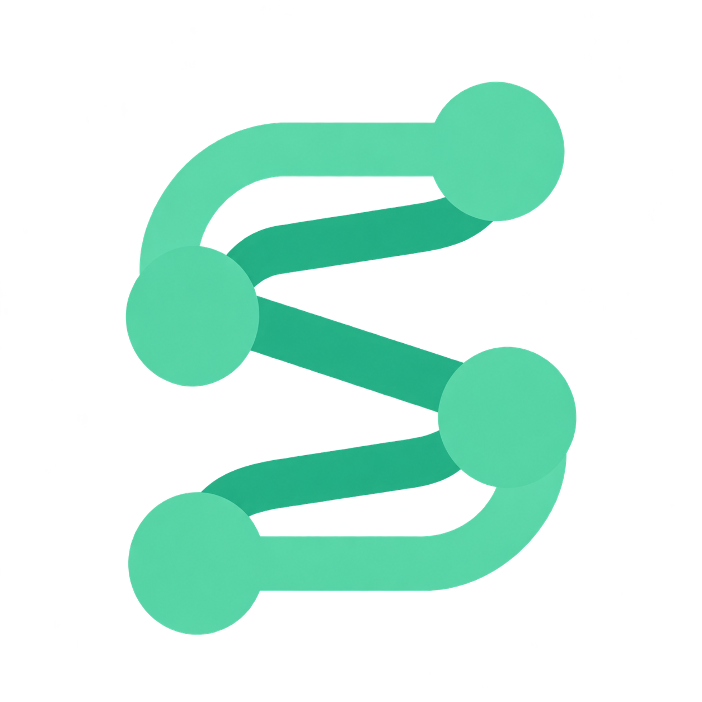

# SwarmLink

SwarmLink is our robotics project for a fleet of at least four robots. The data engineering part collects useful sensor readings and shows them together on a live dashboard.

The first version works with one real TurtleBot3 Burger. It shows battery level, speed, odometry, LiDAR, connection status, and data quality. Testing four physical robots together is the next step.

## Open the dashboard

On the configured Windows laptop, open **[Start Dashboard.exe](data-engineering/Start%20Dashboard.exe)** from the `data-engineering` folder. Connect the laptop and prepared robots to the same reachable Wi-Fi network. Use the red **Shut down dashboard** button when finished.

Each collector start opens a fresh telemetry session. Previous readings, trails, counters, and experiment results disappear from the dashboard. Refreshing a browser tab or opening the launcher twice keeps the current session. The raw archive stays on disk for later offline export.

To add a robot yourself, double-click **[SETUP NEW ROBOT.cmd](data-engineering/SETUP%20NEW%20ROBOT.cmd)**. It guides you through SSH or USB setup, hotspot details, packages, robot identity, and startup services. The robot appears automatically when its agent sends data. [Document 07](documentation/07-new-robot-setup.md) explains the steps; Document 03 covers manual setup.

For installation commands and the separate demo mode, see the [data engineering README](data-engineering/README.md).

## Documentation

Click a document title to open it on GitHub.

| Number | Document | What it explains |
| --- | --- | --- |
| 01 | [Dashboard version 1](documentation/01-dashboard-overview.md) | A simple explanation of the dashboard and its scripts. |
| 02 | [Live robot guide](documentation/02-live-robot-guide.md) | Starting, stopping, fresh sessions, and changing networks. |
| 03 | [Robot setup](documentation/03-robot-setup.md) | Preparing each additional robot to send its data. |
| 04 | [Data contract](documentation/04-data-contract.md) | Message fields, units, and validation rules. |
| 05 | [Operations](documentation/05-operations.md) | Storage, exports, retries, recovery, and troubleshooting. |
| 06 | [Validation](documentation/06-validation.md) | Automated checks, physical tests, and remaining checks. |
| 07 | [Set up a new robot](documentation/07-new-robot-setup.md) | Use the guided launcher to enroll a robot without a chat. |

## Project folders

- [data-engineering](data-engineering/README.md): robot agent, collector, dashboard, launcher, and tests.
- [documentation](documentation/README.md): the numbered project guides.
- [documentation/images](documentation/images/): the [green SwarmLink logo](documentation/images/swarmlink-logo.png) and its generation prompt.
- `simulation/`: reserved for the team's simulation work.
