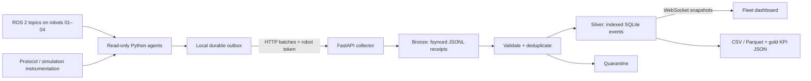

# SwarmLink · data engineering

A runnable local data plane and live dashboard for a fleet of **at least four robots**. It collects useful sensor signals, retains experiment evidence, and exposes data quality instead of treating missing data as a healthy robot.

The implementation and launcher live in `data-engineering/`. Project guides are in the repository's top-level [documentation folder](../documentation/README.md).

For a simple explanation of the first version, read [Document 1](../documentation/document1.md).

**Real robot setup:** `robot-01` has been connected to the live pipeline over Selim's iPhone hotspot. Double-click **[Start Dashboard.exe](Start%20Dashboard.exe)** in this folder to start the live collector and open its page. Use the red **Shut down dashboard** button in the top bar to stop it. See [LIVE_ROBOT.md](../documentation/LIVE_ROBOT.md) for details. The existing local credentials are in ignored `.runtime/robot-keys.json`. Demo and live storage remain separate.

## Run the four-robot demo

Python **3.11 or 3.12** is the recommended host environment. From the repository root, on Windows:

```powershell
cd data-engineering
python -m venv .venv
.\.venv\Scripts\python.exe -m pip install -e ".[analytics,test]"
.\.venv\Scripts\python.exe -m swarmlink_data serve --demo
```

On Linux/macOS, use `.venv/bin/python` in place of `.\.venv\Scripts\python.exe` (create the environment with `python3 -m venv .venv`).

Open **http://127.0.0.1:8765**. Stop the server with Ctrl+C. After installation, Windows users can also run `./scripts/start-demo.ps1` from this directory; it uses the virtual environment when available.

The amber **SYNTHETIC FEED** banner is intentional. This is a seeded telemetry fixture, not physical measurements or an implementation of the team's distributed protocol. Four simulated robots emit telemetry at 2 Hz and synthetic message events. The browser receives a snapshot once per second. Select a robot, pause the feed to see staleness, or test a 12-second dropout. Pausing the feed does not pause the freshness clock.

To exercise a larger fixture:

```powershell
python -m swarmlink_data serve --demo --robots 20 --data .runtime/demo-20
```

## What your DE contribution does

| Data product | Useful signals / behavior |
| --- | --- |
| Fleet observability | Robot identity, last sample time, battery percentage/voltage, linear/angular velocity, odometry and recent trajectories |
| LiDAR view | Uniformly sampled ranges with their angular coordinates, null invalid returns, nearest **retained** return; not a collision avoidance system |
| Reliability | A SQLite outbox on each robot, HTTP batch acknowledgements, reconnect retries with unchanged event IDs, duplicate suppression |
| Data quality | Validated schema, rejected-event quarantine, retry counts, sequence gaps, per-topic freshness, visible clock skew |
| Experiment evidence | Run/scenario/protocol/seed metadata, explicit message/fault/decision events, recipient-based delivery and fault/recovery timing |
| Analytics | Raw JSONL receipts, indexed SQLite events, replayable JSONL, CSV and Parquet exports, reproducible KPI functions |

Odometry origins on different robots are usually independent. The dashboard overlays poses **only** when their producer declares the same `map_id`. The supplied ROS agent leaves `map_id` null; it does not invent a shared map or a localization transform.

## Architecture



Python/FastAPI, SQLite, and a small HTML/Canvas frontend are implementation choices for this initial contribution, ready for team review. A broker or cloud service is not needed to run it. The data contract keeps a later MQTT/Kafka transport possible without forcing one into the first four-robot setup.

## Connect the real robots

Follow [the robot deployment guide](../documentation/ROBOT_SETUP.md). Each robot needs a unique ID (`robot-01` … `robot-04`) and token, the same experiment `run_id`, and an HTTP route to the collector PC. Each agent subscribes to its local `/odom`, `/scan`, and `/battery_state`; ROS discovery does not need to cross the iPhone hotspot to the Windows PC.

On this PC, use `./scripts/start-live.ps1`. For a fresh collector, generate credentials once, then start it. Skip the keys command when the file already exists:

```powershell
python -m swarmlink_data keys --robots 4 --output .runtime/robot-keys.json
python -m swarmlink_data serve --host 0.0.0.0 --keys .runtime/robot-keys.json --robots 1
```

Use a trusted lab/hotspot network. This prototype's dashboard is read-only but visible to devices that can reach the collector. Ingestion requires a different bearer token per robot. HTTP does not encrypt these tokens; use an HTTPS reverse proxy or a private VPN before using an untrusted network. Secrets and runtime data are excluded from Git.

**One physical robot has been validated.** The LDS-01 driver, odometry, battery publisher, and read-only collection agent now run on `robot-01`. Four physical robots have not yet been tested together. The dashboard itself sends no motor commands. Optional robot startup services start the normal TurtleBot bringup and agent independently of the dashboard.

## Instrument the team's protocol

[CONTRACT.md](../documentation/CONTRACT.md) defines the versioned envelope, payloads, timestamp semantics, and HTTP acknowledgements. [The protocol adapter example](examples/protocol_adapter.py) shows how a protocol process can emit durable events without changing its decision logic.

Telemetry cannot establish consensus correctness, delivery, or fault recovery. Protocol code must emit `message_sent`, `message_received`, and explicit fault/detection/recovery events. `decision` is retained for later consensus analysis; agreement and safety proofs are **not** computed by this prototype. The fixture's timings must not be presented as protocol benchmark results.

## Export and replay

Use **Export → CSV / Parquet** for the selected run while the server is running. For an offline export, stop the collector first and use the run ID shown in the dashboard:

```powershell
python -m swarmlink_data export --data .runtime/demo --run YOUR_RUN_ID --output .runtime/exports/YOUR_RUN_ID
```

This writes `events.csv`, `events.parquet`, `events.jsonl`, `metrics.json`, and `manifest.json`. JSON/Parquet preserve nulls and the complete retained scan in `payload_json`. CSV guards strings that a spreadsheet could interpret as formulas. `--no-parquet` works without the analytics extra. Repeating an export replaces these files instead of appending duplicate rows.

Replay exported JSONL or a raw receipt journal into a running collector. For a live collector, set the corresponding robot's `SWARMLINK_ROBOT_TOKEN` in your environment first. Replay filters by robot identity; repeat for each robot:

```powershell
python -m swarmlink_data replay .runtime/exports/YOUR_RUN_ID/events.jsonl --robot-id robot-01
```

Use a separate **demo** collector for simulation replays; live mode rejects simulation-source events. Replaying into the original data directory returns duplicates, preserving analytical counts. Replay does not regenerate sensor readings or play back at the original speed.

## Validate

```powershell
python -m pytest -q
node --check swarmlink_data/static/app.mjs
```

Node is optional and used for the dashboard syntax check; there is no frontend build step. Tests cover the event contract, four-robot authenticated ingestion, WebSocket delivery, retries, ID/sequence collisions, late arrivals, crash recovery, writer exclusion, fault metrics, queue persistence, LiDAR conversion, and export round trips. A 20-robot fixture is a correctness smoke check, not a throughput certification. See [VALIDATION.md](../documentation/VALIDATION.md) for the recorded verification and physical acceptance checklist.

## Repository layout

```text
documentation/
  document1.md               simple explanation of the first dashboard version
  LIVE_ROBOT.md              current deployment and everyday use
  ROBOT_SETUP.md             setup for additional robots
  CONTRACT.md                event format and validation rules
  OPERATIONS.md              storage, recovery, and known limits
  VALIDATION.md              tests and physical verification
data-engineering/
  agents/ros2_agent.py        ROS 2 topic adapter (standard library transport)
  swarmlink_data/
    contracts.py             versioned event validation
    edge.py                  durable outbox + HTTP publisher
    store.py, lease.py       journal, materialization, process ownership
    analytics.py, export.py  shared metrics and portable data products
    app.py                   ingestion, read APIs, WebSocket, export
    simulator.py             explicitly synthetic demo fixture
    static/                  dashboard, no external assets or CDN
  examples/                  protocol integration example
  scripts/                   local launch helper
  tests/                     data correctness and API tests
  .runtime/                  generated local data (ignored)
```

The collector is a single-process local prototype: no automatic retention, high availability, TLS termination, or fleet management. [OPERATIONS.md](../documentation/OPERATIONS.md) documents storage ownership, recovery, scale limits, and how to diagnose missing data.
